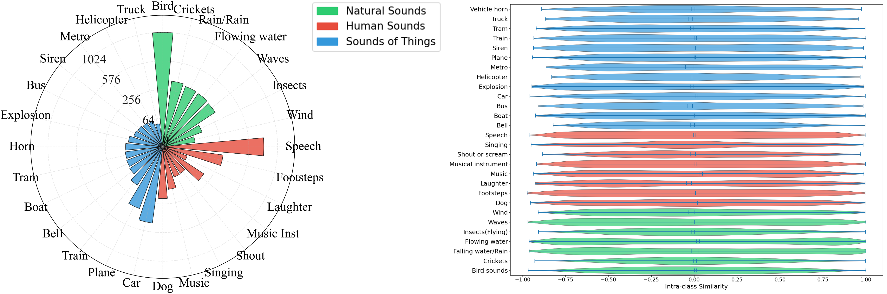
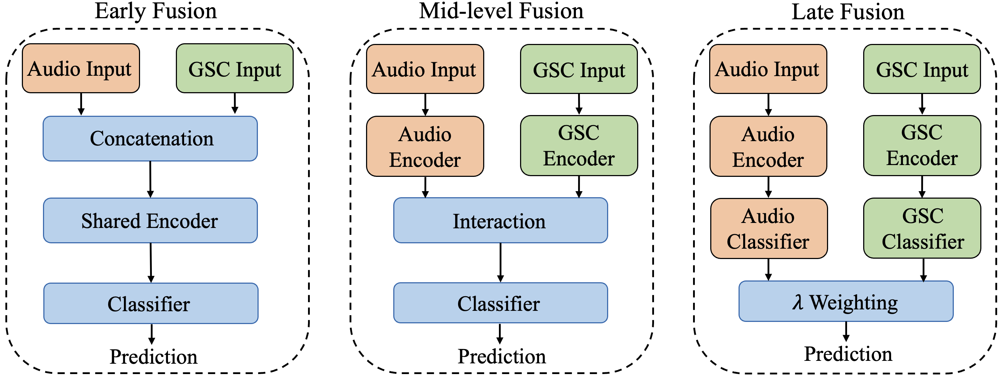
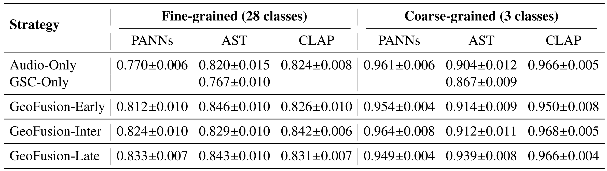
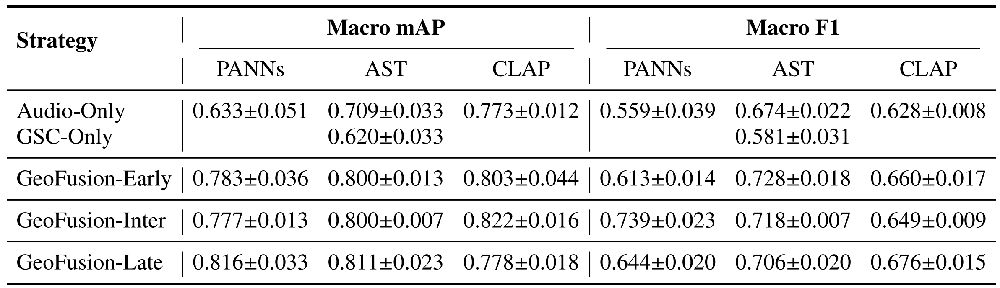
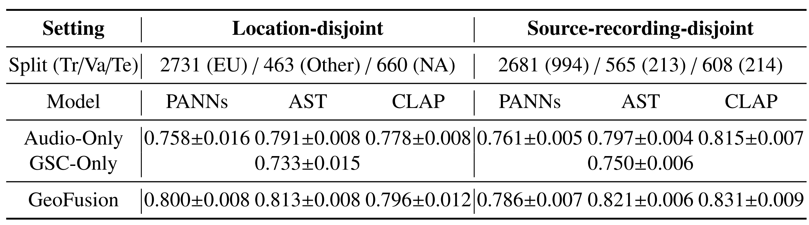

# Geo-ATBench

Geo-ATBench is a benchmark for multi-label sound event tagging that pairs 3,854 real-world audio clips with geospatial semantic context (GSC) derived from nearby OpenStreetMap points of interest. This repository provides the project code and supplementary materials for evaluating audio-only and audio-GSC models across 28 sound-event classes.

[Paper](https://arxiv.org/abs/2603.10623) | [Dataset](https://zenodo.org/records/18980673) | [Leaderboard](https://github.com/WuYanru2002/Geo-ATBench-Leaderboard)

*Figure 1: Summary of sound classes and acoustic similarity. (Left) Distribution of three coarse-grained sound classes. (Right) Intra-class similarity across 28 classes computed from log-Mel spectrogram features.*

*Figure 2: Overall architecture of the GeoFusion-AT framework for the Geo-AT task.*

*Table 1: The micro mean average precision (mAP) of different models on the Geo-ATBench dataset. All metrics are averaged across 5 independent experimental runs. Due to rounding, some results show the same SD of 0.010; for example, the unrounded SD for GeoFusion-Inter-AST is 0.0095.*

*Table 2: Macro-mAP and macro-F1 of different models on the 28-class fine-grained Geo-ATBench task.*

*Table 3: Data split settings and micro-mAP results for the 28-class Geo-ATBench task under disjoint evaluations. For source-recording-disjoint splits, numbers in parentheses indicate unique source recordings.*

In September 2026, supplementary materials were added.
