# Geo-ATBench

Geo-ATBench is a geographically annotated polyphonic audio benchmark for geospatial audio tagging (Geo-AT), a task that uses both audio and geospatial semantic context (GSC) for multi-label audio tagging. The benchmark contains 3,854 real-world audio clips (10.71 hours) across 28 sound event categories. Each clip is paired with a GSC representation derived from points of interest (POIs) across 11 semantic context categories.

## Versioned Resources

| Resource | Version | Location |
| --- | --- | --- |
| Geo-ATBench dataset | Zenodo v1.0 | [Dataset](https://zenodo.org/records/18980673) |
| Geo-ATBench evaluation resources | Zenodo v1.1 | [Evaluation resources](https://zenodo.org/records/24102468) |
| Code, split assignments, and evaluation files | GitHub release v1.1 | [Geo-ATBench](https://github.com/WuYanru2002/Geo-ATBench/releases/tag/v1.1) |

## Contents

- [1. Dataset Details](#1-dataset-details)
  - [1.1 Dataset and Framework](#11-dataset-and-framework)
    - [1.1.1 Freesound Geo-tagged Recordings by Year](#111-freesound-geo-tagged-recordings-by-year)
    - [1.1.2 Recording-Location Coverage by Sound Event](#112-recording-location-coverage-by-sound-event)
    - [1.1.3 Sound-Event and GSC Co-occurrence](#113-sound-event-and-gsc-co-occurrence)
    - [1.1.4 Geographic Distribution by Continent](#114-geographic-distribution-by-continent)
    - [1.1.5 Sound Classes and Intra-Class Similarity](#115-sound-classes-and-intra-class-similarity)
    - [1.1.6 GeoFusion-AT Framework](#116-geofusion-at-framework)
  - [1.2 GSC Construction](#12-gsc-construction)
- [2. Results](#2-results)
  - [2.1 Main Results](#21-main-results)
    - [2.1.1 Micro-mAP Comparison Across Models](#211-micro-map-comparison-across-models)
    - [2.1.2 Macro-mAP and Macro-F1 Comparison](#212-macro-map-and-macro-f1-comparison)
    - [2.1.3 GSC-only Performance Across POI Ranges](#213-gsc-only-performance-across-poi-ranges)
    - [2.1.4 Zero-Shot Audio-Only ROC Curves](#214-zero-shot-audio-only-roc-curves)
  - [2.2 Related Analysis](#22-related-analysis)
    - [2.2.1 Disjoint Evaluation Results (Micro-mAP)](#221-disjoint-evaluation-results-micro-map)
    - [2.2.2 Fusion Operation Ablations (Macro-F1)](#222-fusion-operation-ablations-macro-f1)
    - [2.2.3 GSC Shuffle and Noise Perturbations](#223-gsc-shuffle-and-noise-perturbations)
    - [2.2.4 t-SNE of Audio Representations](#224-t-sne-of-audio-representations)
  - [2.3 Temporal Consistency of POI Text and GSC Embeddings](#23-temporal-consistency-of-poi-text-and-gsc-embeddings)
- [3. Dataset Splits and Pretrained Checkpoints](#3-dataset-splits-and-pretrained-checkpoints)
  - [3.1 Dataset Split](#31-dataset-split)
  - [3.2 Source-Recording-Disjoint Split](#32-source-recording-disjoint-split)
  - [3.3 Location-Disjoint Split](#33-location-disjoint-split)
  - [3.4 Pretrained Checkpoints](#34-pretrained-checkpoints)

## 1. Dataset Details

### 1.1 Dataset and Framework

#### 1.1.1 Freesound Geo-tagged Recordings by Year

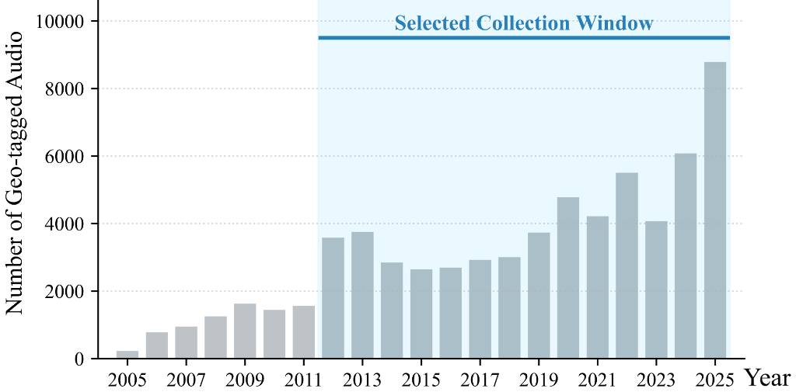

*The number of recordings with GPS information in Freesound by year, based on the metadata provided by Freesound.*

#### 1.1.2 Recording-Location Coverage by Sound Event

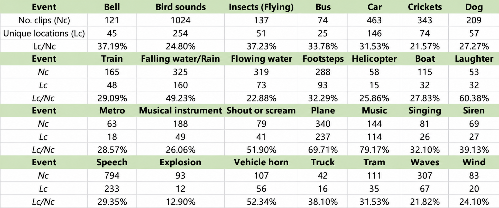

*Clip counts, unique recording locations, and their ratios by sound-event class.*

#### 1.1.3 Sound-Event and GSC Co-occurrence

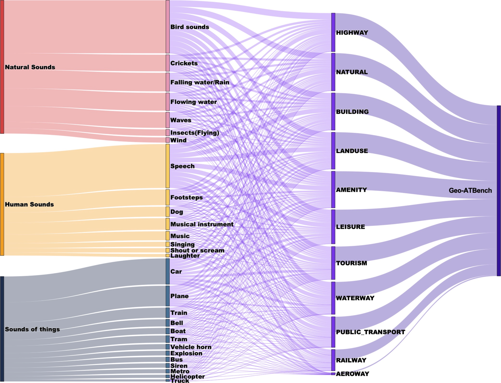

*Sankey diagram linking three coarse sound groups, 28 sound-event classes, and 11 OSM feature categories. Each event-to-OSM link is weighted by the number of 10-second clips containing both the event label and the OSM category in its GSC.*

#### 1.1.4 Geographic Distribution by Continent

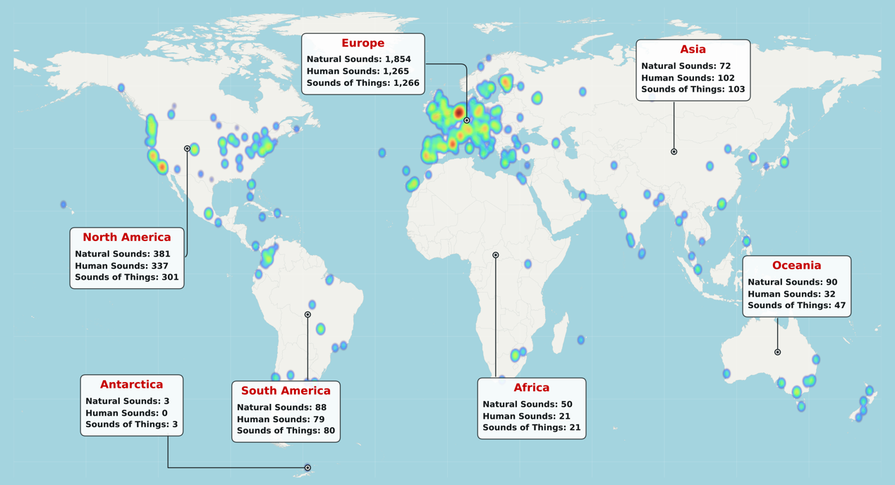

*Recording locations and sound-category counts by continent.*

#### 1.1.5 Sound Classes and Intra-Class Similarity

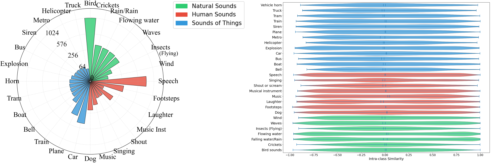

*Summary of sound classes and acoustic similarity. (Left) Distribution of three coarse-grained sound classes. (Right) Intra-class similarity across 28 classes computed from log-Mel spectrogram features.*

#### 1.1.6 GeoFusion-AT Framework


*Overall architecture of the GeoFusion-AT framework for the Geo-AT task.*

### 1.2 GSC Construction

GSC is the mean of the 768-dimensional BERT `[CLS]` vectors for retained OSM tags across 11 feature categories.

The following Overpass Turbo example retrieves entities within a 1000 m radius of 51.716783, 5.197393 and displays them on an interactive map. This circular query is an example of map inspection; the 1000 m extraction range used in the dataset denotes a square side length.

```overpass
[out:json][timeout:25];
(
  node(around:1000,51.716783,5.197393);
  way(around:1000,51.716783,5.197393);
  relation(around:1000,51.716783,5.197393);
);
out center tags;
```

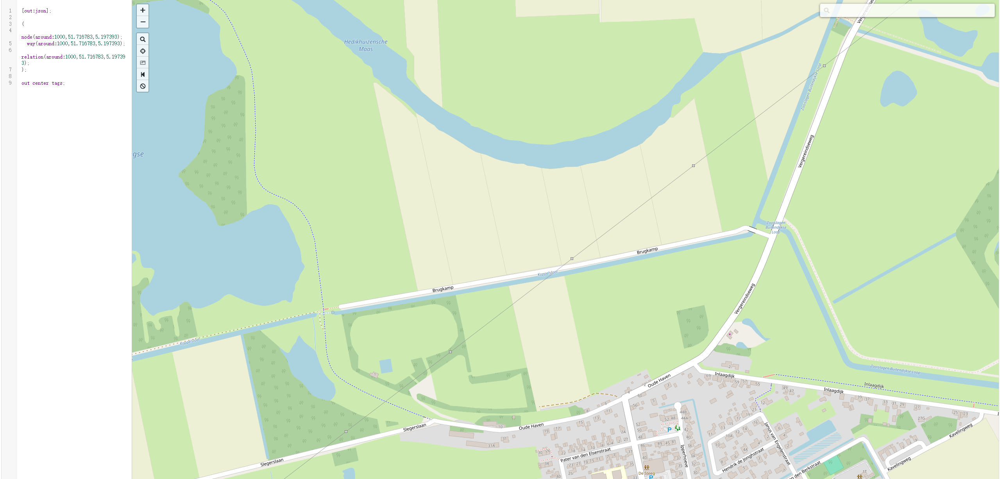

*Overpass Turbo query and interactive-map visualization.*

## 2. Results

### 2.1 Main Results

#### 2.1.1 Micro-mAP Comparison Across Models

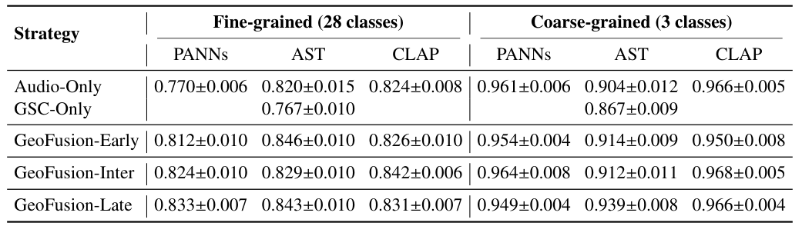

*The micro mean average precision (mAP) of different models on the Geo-ATBench dataset. All metrics are averaged across 5 independent experimental runs.*

#### 2.1.2 Macro-mAP and Macro-F1 Comparison

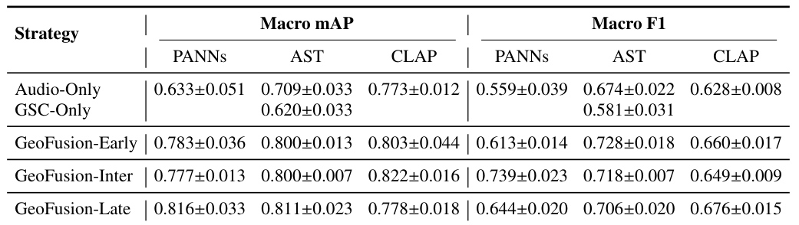

*Macro-mAP and macro-F1 of different models on the 28-class fine-grained Geo-ATBench task.*

#### 2.1.3 GSC-only Performance Across POI Ranges

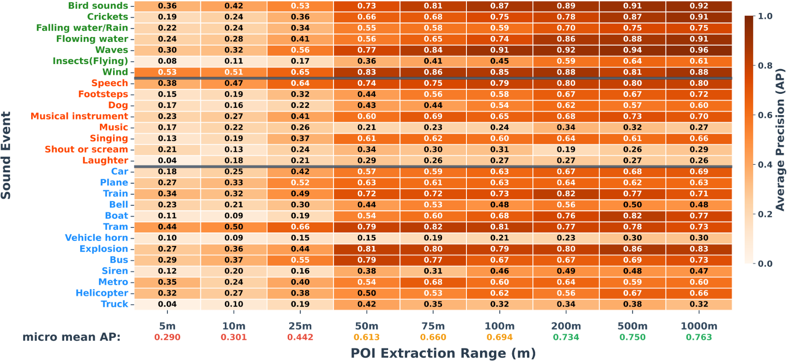

*Average Precision (AP) and micro-mAP for GSC-only multi-label tagging under different POI extraction ranges on the Validation set. The POI extraction range denotes the square side length; e.g., 1000 m corresponds to a 1000 m × 1000 m square centered at the GPS coordinate, with the GPS point 500 m from each side. POI-derived GSC is constructed from OSM entities retrieved with the 11 OSM feature keys.*

#### 2.1.4 Zero-Shot Audio-Only ROC Curves

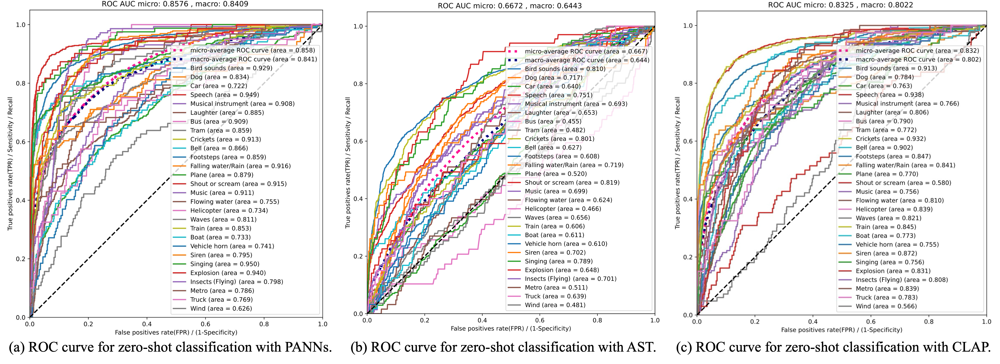

*ROC curves for zero-shot audio-only tagging on Geo-ATBench: PANNs and AST use pretrained AudioSet predictions mapped to 28 classes, while CLAP uses direct audio–text similarity with target-class prompts. Micro/Macro ROC AUC: PANNs (0.8576/0.8409), AST (0.6672/0.6443), CLAP (0.8325/0.8022).*

### 2.2 Related Analysis

#### 2.2.1 Disjoint Evaluation Results (Micro-mAP)

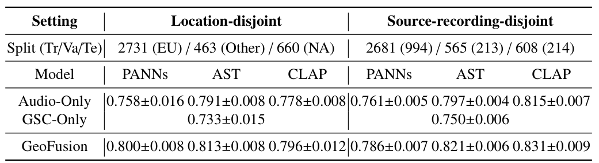

*Data split settings and micro-mAP results for the 28-class Geo-ATBench task under source-recording-disjoint and location-disjoint evaluations.*

#### 2.2.2 Fusion Operation Ablations (Macro-F1)

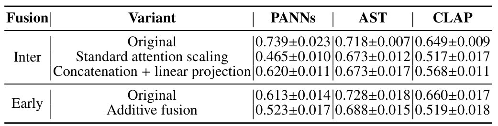

*Macro-F1 of original and alternative fusion variants on the 28-class Geo-ATBench dataset.*

#### 2.2.3 GSC Shuffle and Noise Perturbations

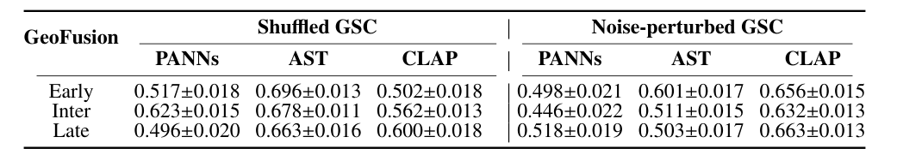

*Macro-F1 (mean ± SD across five runs with independently generated random perturbations) under shuffled and noise-perturbed GSC inputs for the GeoFusion configurations.*

#### 2.2.4 t-SNE of Audio Representations

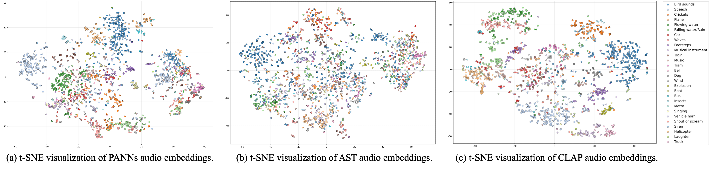

*t-SNE visualization of audio representations.*

### 2.3 Temporal Consistency of POI Text and GSC Embeddings

*Comparison of historical and current GSC, as reported in the manuscript. Parentheses indicate the number of test clips.*

| Metric | 2012–2015 (71) | 2016–2020 (252) | 2021–2025 (256) | Overall (579) |
| --- | ---: | ---: | ---: | ---: |
| Raw POI text overlap (%) | 88.87 | 93.40 | 90.39 | 91.51 |
| GSC embedding cosine similarity | 0.9886 | 0.9921 | 0.9890 | 0.9903 |

## 3. Dataset Splits and Pretrained Checkpoints

### 3.1 Dataset Split

| Partition | Clips | Assignment file |
| --- | ---: | --- |
| Train | 2,697 | [train.csv](Related_analysis/version_1.1/splits/original_split/train.csv) |
| Validation | 578 | [validation.csv](Related_analysis/version_1.1/splits/original_split/validation.csv) |
| Test | 579 | [test.csv](Related_analysis/version_1.1/splits/original_split/test.csv) |
| Total | 3,854 | |

### 3.2 Source-Recording-Disjoint Split

All clips from the same source recording are assigned to a single partition.

| Partition | Clips | Unique source recordings | Unique locations | Unique uploaders | Duration (s) |
| --- | ---: | ---: | ---: | ---: | ---: |
| Train | 2,681 | 994 | 895 | 575 | 26,810 |
| Validation | 565 | 213 | 198 | 156 | 5,650 |
| Test | 608 | 214 | 208 | 149 | 6,080 |

[Clip-to-source mapping](Related_analysis/version_1.1/splits/recording_disjoint/clip_to_source_split.csv): clip ID, source recording ID, and partition.

### 3.3 Location-Disjoint Split

Entire continents are assigned to separate partitions.

| Partition | Continents | Clips | Assignment file |
| --- | --- | ---: | --- |
| Train | Europe | 2,731 | [train.csv](Related_analysis/version_1.1/splits/location_disjoint/train.csv) |
| Validation | Africa, Antarctica, Asia, Oceania, South America | 463 | [validation.csv](Related_analysis/version_1.1/splits/location_disjoint/validation.csv) |
| Test | North America | 660 | [test.csv](Related_analysis/version_1.1/splits/location_disjoint/test.csv) |

### 3.4 Pretrained Checkpoints

| Backbone | Checkpoint |
| --- | --- |
| PANNs | [Cnn14_mAP=0.431.pth](https://zenodo.org/records/3987831/files/Cnn14_mAP%3D0.431.pth?download=1) |
| AST | [audioset_10_10_0.4593.pth](https://www.dropbox.com/s/cv4knew8mvbrnvq/audioset_0.4593.pth?dl=1) |
| CLAP | [CLAP_weights_2022.pth](https://huggingface.co/microsoft/msclap/resolve/main/CLAP_weights_2022.pth) |
